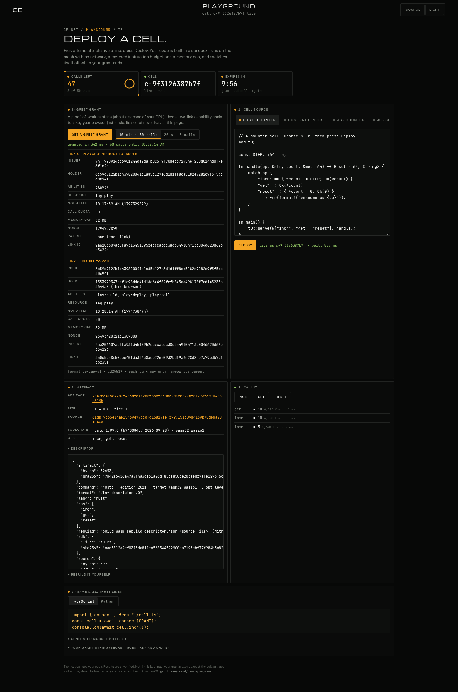
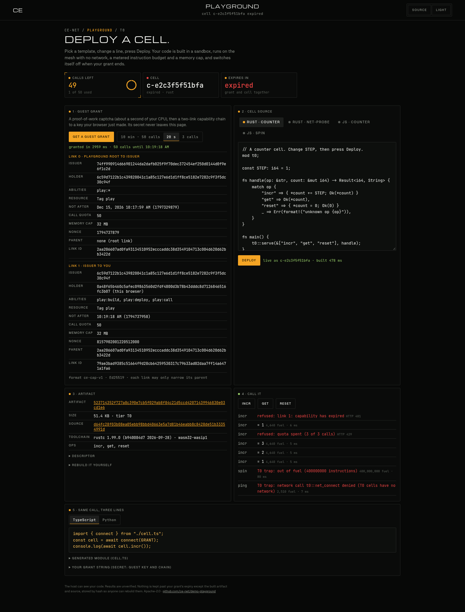

# ce-net Playground

Write a cell in your browser, press Deploy, and a few seconds later it is running in a sandbox and you can call it.
Every call is metered, the network is closed, and the cell switches off when your grant expires.



What one visit does:

1. **Guest grant.** Your browser makes an Ed25519 key and solves a proof-of-work captcha (about a second).
   `play.grant@1` returns a two-link capability chain (format `ce-cap-v1`, byte-compatible with ce-net's ce-cap):
   playground root to issuer, then issuer to your key with `play:build`, `play:deploy`, `play:call`, a call quota
   (`max_credits`), a 32 MB memory cap and a `not_after` at most 10 minutes away. The page shows every field of
   every link. The secret key never leaves the page, and every request is signed with it.
2. **Build.** `build.wasm@1` compiles your Rust (rustc, `wasm32-wasip1`) or JavaScript (Javy 9.1.0) in a
   bubblewrap jail with no network, no home directory and CPU, time and size limits. It returns the artifact hash and
   a descriptor naming the source hash, SDK hash, toolchain and exact command, so anyone can rebuild the same bytes.
3. **Deploy.** `cell.host` fetches the artifact by hash, checks the hash, and precompiles it inside the jail.
4. **Call.** Each call is one fresh `ce-t0` process in the jail: no key, no network, a 400M-instruction fuel
   budget, a 32 MB memory cap and a 2 s deadline. Calls that try to reach the network stop with a T0 trap that
   names the call. Calls after the quota or after `not_after` are refused.
5. **Client.** `client.gen@1` writes a typed TypeScript or Python module for your cell, one method per op, and the
   three lines that call it.

## Run it in under 5 minutes

Needs Linux with `bwrap` (bubblewrap) and `prlimit`, a recent stable Rust (1.90 or newer) with the `wasm32-wasip1` target, and a Chromium,
Firefox or Safari recent enough to have Ed25519 in WebCrypto.

```sh
git clone https://github.com/ce-net/demo-playground && cd demo-playground
rustup target add wasm32-wasip1
cargo build --release                          # about 2-4 minutes, mostly wasmtime
# optional, for JavaScript cells: Javy 9.1.0 from github.com/bytecodealliance/javy/releases
#   mkdir -p ~/.local/share/demo-playground/toolchain && gunzip -c javy-*-linux-v9.1.0.gz > ~/.local/share/demo-playground/toolchain/javy && chmod +x $_
B=target/release
$B/play-grant serve & $B/build-wasm serve & $B/cell-host serve & $B/client-gen serve &
$B/play-door serve 127.0.0.1:7860 web
```

Open http://127.0.0.1:7860, press **Get a guest grant**, change `STEP` and press **Deploy**.

To run it as a service, copy `deploy/systemd/*.service` to `~/.config/systemd/user/`, put the binaries in
`~/.local/share/demo-playground/bin/` and `web/` in `~/.local/share/demo-playground/web/`, then
`systemctl --user enable --now play-grant play-build-wasm play-cell-host play-client-gen play-door`.
Put any HTTPS reverse proxy or tunnel in front of `127.0.0.1:7860` and set `PLAY_PUBLIC_URL` on the door.

Refusals as the page shows them: a network call stopped by a T0 trap, an endless loop out of fuel, the fourth call
on a three-call grant, and a call after the grant expired.



## Rebuild an artifact yourself

Every build publishes its descriptor and source by hash at `/api/blob/<sha256>`. Either use the tool:

```sh
curl -so descriptor.json https://play.ce-net.com/api/blob/<descriptor sha256>
curl -so main.rs        https://play.ce-net.com/api/blob/<source sha256>
target/release/build-wasm rebuild descriptor.json main.rs      # prints MATCH or MISMATCH
```

or run the descriptor's `command` with plain rustc (same version) in a directory holding `main.rs` and
[`sdk/t0.rs`](sdk/t0.rs). Builds are reproducible across machines: an artifact built in the jail on an aarch64 server
rebuilt to the identical sha256 with plain rustc on an x86_64 desktop.

## Cells

One process per cell, each replaceable on its own. They speak JSON over HTTP (`POST /<Op>`) on loopback; only the door
listens for visitors.

| Cell | Ops | Crate |
|---|---|---|
| `play.grant@1` | `Root`, `Challenge`, `Guest{challenge, nonce, guest_pub, ttl_s?, calls?}`, `Decode{chain}` | [crates/play-grant](crates/play-grant) |
| `build.wasm@1` | `Build{lang, src, grant}`, `Get{sha256}`, `Templates` | [crates/build-wasm](crates/build-wasm) |
| `cell.host` | `Deploy{artifact_sha256, descriptor, grant}`, `Call{instance, op, grant}`, `Usage`, `Stop` | [crates/cell-host](crates/cell-host) |
| `ce-t0` | worker binary: `compile`, `run` (one call under T0 limits) | [crates/ce-t0](crates/ce-t0) |
| `client.gen@1` | `Gen{descriptor, lang: ts\|py, instance}` | [crates/client-gen](crates/client-gen) |
| door | routes `/api/*` to the cells, serves `web/`, per-address request budget | [crates/play-door](crates/play-door) |

Libraries: [play-cap](crates/play-cap) (the `ce-cap-v1` token: encode, decode, verify, checked against the
format's golden vector), [play-http](crates/play-http) (the JSON wire).

A request that needs a right carries `grant: {chain, ts, sig}`, where `sig` is the guest key's Ed25519 signature
over `play-call-v0\n<target>\n<op>\n<ts>` (target: `build`, the artifact hash, or the instance id).

## The T0 cell protocol (v0)

A cell is a WASI preview1 command. It reads `<op> <state>` on stdin (state is an i64) and writes
`= <result> <new state>`, `! <error>`, or for `__describe`, `ops <op1>,<op2>`. The SDKs in [sdk/](sdk/) do this for you;
templates are in [templates/](templates/). Imports other than WASI preview1 (and WASI sockets) are bound to functions
that trap with their name.

## Tests

```sh
cargo test --release
```

`ce-t0` tests: the protocol, a network import and a WASI socket call trapping by name, an endless loop stopped by
fuel and, with fuel unlimited, by the deadline, memory growth past the cap. `play-cap`: the golden vector,
attenuation (expired, wider abilities, wider quota, tampered link), holder proof. `client-gen`: one method per op,
hostile op names and door URLs refused.

## Limits of this first version

- State is one i64 per cell, kept in memory by `cell.host`; a restart of `cell.host` ends live cells.
- One host. Placement across machines and moving a running cell come later.
- Rust and JavaScript only. JavaScript cells are about 1.3 MB (they carry QuickJS), so their first deploy takes
  several seconds; Rust cells deploy in about one.
- The host can see your code, and results are not verified by a second party.

## License

Apache-2.0. Author: Leif Rydenfalk.
